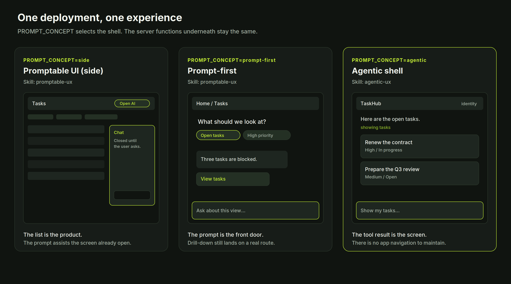
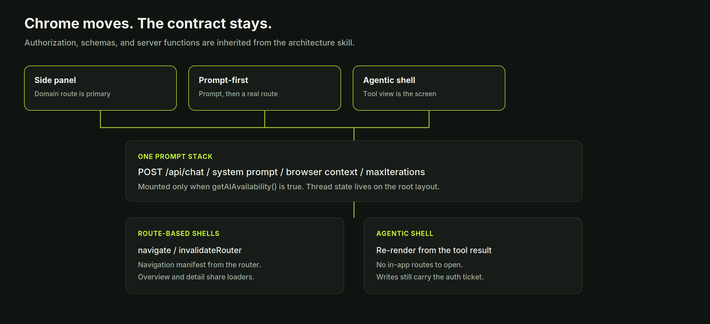
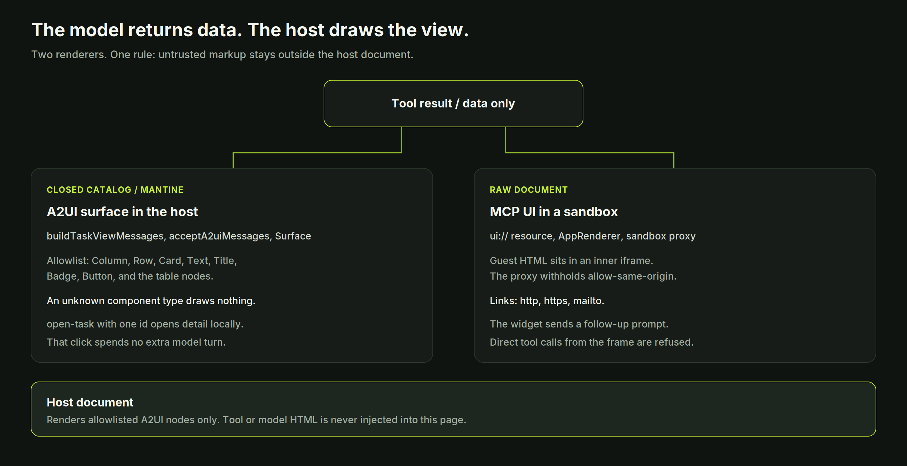

[Building AI-promptable full-stack apps](@/building-ai-promptable-fullstack-apps/index.md) fixed the contract under the screen: every external service sits behind an interface, schemas cross boundaries with `Schema.parse()`, and the UI and the assistant call the same server functions. That contract still leaves a product decision open. What does a person see on first paint, and where does the prompt live?

The template now answers that with **three UI skills**. Two of them share an Agent Skill file, because they still have domain screens. The third is its own skill, because it does not.

- **Promptable UI (side).** Agent Skill `promptable-ux`. `PROMPT_CONCEPT=side`, which is the default. First paint is the domain screen.
- **Prompt-first.** Agent Skill `promptable-ux`. `PROMPT_CONCEPT=prompt-first`. First paint is the prompt.
- **Agentic shell.** Agent Skill `agentic-ux`. `PROMPT_CONCEPT=agentic`. First paint is the prompt, and the prompt is the product.

- [GitHub repository](https://github.com/carlosvin/tanstack-fullstack-ai-template)
- [Side demo](https://fullstack-promptable-app-example.netlify.app)
- [Prompt-first demo](https://fullstack-promptable-prompt-first.netlify.app)
- [Agentic demo](https://fullstack-promptable-agentic.netlify.app)

One codebase builds all three. Each Netlify site sets `PROMPT_CONCEPT` and keeps that declaration. A new app that has not chosen yet should be asked which of the three to build. The answer gets recorded. Scaffolding waits.



*One deployment, one experience. The server functions underneath do not change when the shell does.*

## What every shell inherits

The UX skills are companions of `tanstack-promptable-fullstack-app-template`. They place the prompt and, in the agentic case, decide how a tool result becomes pixels. They leave schemas, loaders, authorization, and the agent loop on the architecture skill.



*Chrome is a deployment setting. The prompt stack, the auth ticket, and the server functions are shared.*

Shared rules:

1. **The prompt exists only when AI is configured.** `getAIAvailability()` gates it. A greyed-out composer is a second product. Omit the prompt and leave the rest of a route-based app usable. The agentic shell has no domain UI behind the prompt, so an unconfigured site shows an empty configuration state.
2. **One prompt stack.** `/api/chat`, the system prompt (base instructions, navigation manifest where routes exist, current user, browser context), and an explicit `agentLoopStrategy: maxIterations(N)`. Conversation state mounts on the root layout, so a route change or a scroll keeps the thread.
3. **Mobile first, both color schemes.** A usable layout at the narrowest width, then more room as the viewport grows. Theme tokens, one icon library.
4. **Authorization stays on the server.** Hiding a button is presentation. Mutations still pass the access ticket, and writes still carry `TraceabilityContext`.

Route-based skills add two client tools, `navigate` and `invalidateRouter`, and a navigation manifest built from the router (`routesById`, route descriptions, `.describe()` on search fields). A new screen is missing from the assistant until it is in that manifest. Dynamic routes need a current-location rule so "this task" resolves to the id on screen. Filters stay in validated search params. Overview cards and detail pages call the same loaders.

The agentic shell drops those client tools and the manifest. There is one route. After a write, the host re-renders from the new tool result.

## Promptable UI (side)

Use this when browsing, filtering, and detail pages are the job, and the assistant helps with what is already on screen. Operational consoles, review queues, and admin tools belong here. Extending this template as-is uses this skill.

The current route is the product: overview, list, or detail. The prompt starts closed. A persistent control on every screen opens it, including when the header collapses on a narrow viewport (`aria-label="Open AI chat"` in the reference app). Wide viewports use a side panel. The narrowest viewport may cover the screen. Closing the panel returns to the same route and keeps the thread. Opening it must keep the URL search state. An internal link in an assistant message navigates while the panel and the thread stay put.

A column that is always visible is the prompt-first skill. Ship one surface.

In the reference app, `AppLayout` mounts `ChatDrawer` closed. `Header` opens it. The panel is a right-side drawer and becomes the full viewport below the `sm` breakpoint. It is a drawer, and it stays out of `AppShell.Aside`.

Assistant replies render as Markdown, including GFM tables, code, and links. Internal paths such as `[Tasks](/tasks)` stay client-navigable through the project `Link` (`search: true`, `preload="intent"`). Enter sends. Shift+Enter inserts a newline. The thread shows a short tool-status label, a thinking state, and errors in an alert. Suggested prompts can come from the single help document, `docs/help.md`.

Every area the prompt can open also has a visible control, so the app works before the model replies.

## Prompt-first

Use this when the job starts as a question and the screen is the evidence. The prompt is on screen at first paint. It is the top of the experience, pinned to the bottom of the viewport, in the shape people already know from chat products: a stage for the thread, a composer that stays reachable.

Layout, top to bottom:

1. **App bar.** Identity, current location, navigation. Keep it small.
2. **Conversation stage.** Empty state: welcome text and starter chips. Later: a scrollable thread with Markdown, tables, and internal route links.
3. **Bottom-pinned composer.** Autosizing input, send and stop, quick actions. In this template it sits in `AppShell.Footer`.
4. **Drill-down routes.** Lists, detail views, and forms stay on real routes (`/tasks`, `/tasks/$taskId`) with the same loaders as the rest of the app. The composer remains available so a command can refer to the record on screen.

The landing surface is the conversation. Stacking the full dashboard under the composer produces two products on one page. When AI is off, the ordinary overview stands on its own and the prompt is absent.

This shell has the same prompt stack as the side panel, including `PromptChatProvider`, so the thread survives navigation into a detail route. It does not also mount `ChatDrawer`.

The enterprise property worth keeping: a filtered list still has a URL. A link in the thread, a bookmark, and an audit review land on the same route.

## Agentic shell

Use this when the conversation is the product and a parallel information architecture would only duplicate the tools. The cost is explicit. Shareable filtered URLs and in-app navigation go away. Pick the shell when that cost is acceptable: a focused internal assistant, a single-purpose operator, a surface whose screens would otherwise be thin wrappers over the same tool calls.

The reference shell is identity in the app bar (name visible, version in a tooltip), a centered column, and a bottom-pinned composer. The column and the composer share one width, capped so a line stays readable on a wide monitor. Empty state starters ask for views (`Show my tasks`, a status filter, a priority filter). They do not point at dashboards. Tool status is a sentence (`showing tasks`). A list answer is one short sentence plus the view. The view already shows titles, statuses, and owners.

"My tasks" means every task. `assignee` is set when the person names someone. A demo visitor identity is not a filter, and the list tool drops that email before it queries, so the view is a real list. Greetings and "what can you do" stay text. A route-shaped markdown link becomes the next prompt, because this shell has no pages.

The model returns data. It does not return markup. The kit decides the renderer. This template's kit is Mantine 9 and `lucide-react`.



*Closed catalogs render in the host through an allowlist. Raw documents render in a sandbox. The host page does not receive tool HTML.*

**Closed catalog.** `showTasksView` and `showTaskView` return task data. `presentation: "table"` draws one row per task. `"cards"`, or omitting the field, draws the card list. `buildTaskViewMessages` turns the payload into [A2UI](https://a2ui.org/) messages. `acceptA2uiMessages` drops any component type outside the catalog before `processMessages`. The host renders with `useA2uiProcessor` and `Surface`, mapped onto the existing `MantineProvider`: `Column`, `Row`, `Card`, `Text`, `Title`, `Badge`, `Button`, and the table nodes. An unknown type draws nothing. People-facing text uses `literalString`. A list row is one control for the whole card. Above 20 matches, the heading keeps the full count and the view says how many rows are shown.

`@a2ui-bridge/react-mantine` peers Mantine 8 and a second icon set. This template keeps `@a2ui-bridge/core` and `@a2ui-bridge/react` and maps the catalog in the host.

**UI actions stay small.** `open-task` with one id opens that detail from data the thread already holds, or loads it from the repository, and spends no extra model turn. The seed repository replays earlier tool results at the start of the next chat turn, because a new serverless instance does not keep the in-memory write. `back-to-list` is an ordinary prompt. Any other action name is ignored.

**Raw documents.** Charts, WebGL, and third-party embeds stay [MCP UI](https://mcpui.dev/) resources. Register the view with `resourceDefinition`, link the tool with `metadata._meta.ui.resourceUri`, and return only data from `execute`. `chat({ mcp: { clients } })` reads the resource and emits a `UIResourcePart`. The host renders it with `AppRenderer` from `@mcp-ui/client`. `sandbox.url` is `public/sandbox_proxy.html`. The proxy keeps guest HTML in an inner iframe and withholds `allow-same-origin`. The guest uses `@modelcontextprotocol/ext-apps` `App` from `public/mcp-app.js`. Direct tool calls from the frame are refused at `POST /api/mcp-apps/call`, so a write still goes through the chat tools and the auth ticket. Allowed link schemes are `http`, `https`, and `mailto`.

Allowlist `ui://` URIs, check the MIME type, and cap the document size. Log the resource URI, tool latency, and render failures through the observability interface.

## How an agent is supposed to choose

Install the parent architecture skill with the UX skill that matches the declaration:

```bash
npx skills add carlosvin/tanstack-fullstack-ai-template --skill tanstack-promptable-fullstack-app-template
npx skills add carlosvin/tanstack-fullstack-ai-template --skill promptable-ux
npx skills add carlosvin/tanstack-fullstack-ai-template --skill agentic-ux
```

`npx skills add carlosvin/tanstack-fullstack-ai-template --list` shows the full set, including `observability-and-env`, `reference-tech-stack`, and `repository-architecture`. Load `reference-tech-stack` when the work must match this template's widgets. Load `observability-and-env` when the shell also touches `shellSession` or logging.

Routing inside the skills:

| The work | Load |
| --- | --- |
| Side panel, prompt bar, assistant markdown, mobile layout, navigation manifest | `promptable-ux` |
| Agentic shell, A2UI catalog, MCP UI host | `agentic-ux` |
| Schemas, routes, tools, server boundaries, availability gate | `tanstack-promptable-fullstack-app-template` |
| Which package this template uses | `reference-tech-stack` |
| File paths and widget snippets | `AGENTS.md` in the template |

Pressure checks live next to the skills and run with `pnpm skills:waza`. A few of them are worth knowing as review questions:

- Moving the reference app's chat into an always-visible column is a concept change. Ask before switching. Leave `PROMPT_CONCEPT=side` in place on that site.
- A scaffold that has not named a shell stops and asks. It does not guess.
- Flattening assistant replies to plain text fails the route-based skills. Tables, code, and internal links stay.
- An agentic deployment does not grow a navbar, a drawer, or a drill-down route beside the shell.

## A portfolio rule

Classify the app before the first route exists.

1. Name the primary actor and the first thing they must see: a queue, a question, or a conversation.
2. Set `PROMPT_CONCEPT` and store that choice with the architecture decision.
3. Install the architecture skill and the one UX skill that owns the choice.
4. Keep schema, repository, and authorization work on the architecture skill. The UX skill changes composition.

Three Netlify sites from this repository are the reference for that rule: same build, three declared experiences, three review checklists. Teams can add a domain by following the architecture flow (schema, repository, server function, tool, route). The shell they already declared decides whether that route is a page people navigate, a page the prompt drills into, or a view the agent renders from the tool result.

- [Architecture, the previous post](@/building-ai-promptable-fullstack-apps/index.md)
- [Repository](https://github.com/carlosvin/tanstack-fullstack-ai-template)
- [Side](https://fullstack-promptable-app-example.netlify.app) · [Prompt-first](https://fullstack-promptable-prompt-first.netlify.app) · [Agentic](https://fullstack-promptable-agentic.netlify.app)
